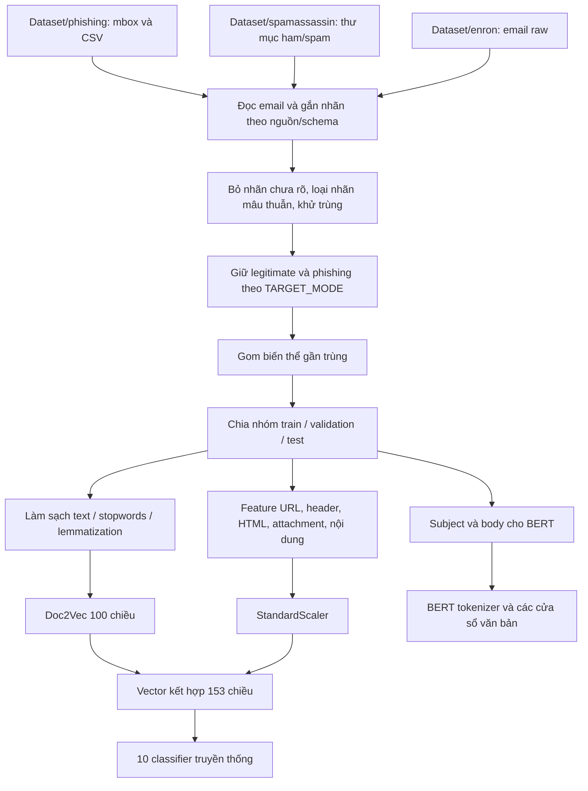

# Rà soát load và tiền xử lý dataset

Ngày rà soát: 15/10/2026.

Đây là đánh giá trước đợt tối ưu. Các thay đổi sau rà soát, gồm sửa phủ định,
cache/xử lý song song, sổ đối soát và năm nhánh chuyên trách, được mô tả trong
[SPECIALIST_PIPELINE.md](SPECIALIST_PIPELINE.md). Các số liệu bên dưới vẫn mô tả
lần training cũ, không phải kết quả của các nhánh mới.

Phạm vi: `load_data.py`, `preprocess.py`, `train.py`, các báo cáo load/lọc dữ liệu và metadata/array của lần training đã lưu. Không chạy lại toàn bộ loader hoặc training. Các con số đầu vào lấy từ báo cáo đã lưu; số dòng báo cáo, metadata, giao nhau giữa các tập, checksum của 7 CSV và một số hành vi tiền xử lý được kiểm tra trực tiếp.

## 1. Nhận định chính

Pipeline đã có nhiều bước đúng: giữ bytes của email raw, phân biệt spam với phishing, loại nhãn mâu thuẫn, gom biến thể trước khi chia tập, fit Doc2Vec và scaler chỉ trên train. Tuy nhiên, dữ liệu raw và CSV có lượng thông tin khác nhau; nhãn phụ thuộc nhiều vào nguồn; bước làm sạch Doc2Vec làm mất phủ định dạng viết tắt. Đây là các vấn đề cần xử lý trước khi tăng độ phức tạp model.

## 2. Luồng thực tế



Entry point là `train.load_training_emails()`. Hàm gọi ba loader riêng; `load_all_datasets()` có tồn tại nhưng không được pipeline training hiện tại sử dụng.

## 3. Load dữ liệu và xác định nhãn

### Email raw và mbox

- Email raw được đọc thành bytes. Mbox được tách thành từng message bằng `mailbox.mbox`.
- Loader đọc đệ quy, dùng tối đa 8 luồng đọc file, xử lý theo batch 64 file.
- Metadata như README được bỏ qua. File archive nằm ngoài email phải được giải nén trước; đây là quy định riêng của loader dataset, khác với quét ZIP đính kèm trong email.
- `Text` thực tế có thể chứa toàn bộ raw MIME dạng bytes; tên cột này không có nghĩa dữ liệu đã được chuyển thành plain text.
- File raw không có header được nhận diện trong 8.192 byte đầu được giữ với nhãn unknown để xem lại, không đem train như legitimate.

### CSV

- `_read_csv_emails()` đọc bằng UTF-8 BOM-aware và nhận diện các alias của cột text/subject/body/label.
- Nếu có raw email thì giữ raw email. Với các CSV đang có chỉ gồm subject/body và một số header, code tạo một MIME email từ những trường có sẵn.
- Quá trình tạo MIME không thể khôi phục header, attachment, cấu trúc multipart hay bytes tài liệu không tồn tại trong CSV.
- Không nhận cột dữ liệu vector làm email raw. Bảy CSV vectorized hiện có chỉ chứa các cột `0`, `label`; chúng được đếm và bỏ qua.
- Dòng sai số lượng trường bị cách ly, tránh lệch cột nội dung và nhãn.
- Cột `urls` trong một số CSV không được sử dụng trực tiếp; feature URL được trích lại từ nội dung email.

### Quy tắc nhãn hiện tại

| Nguồn | Quy tắc trong code |
|---|---|
| Archive Nazario có tên được đăng ký | `Class=1`, `LabelKind=phishing` |
| Raw email trong `Dataset/enron` | Mặc định `Class=0`, theo giả định corpus của caller |
| Thư mục ham/easy_ham/hard_ham của SpamAssassin | `Class=0`, `legitimate` |
| Thư mục spam/spam_2 của SpamAssassin | `Class=1`, `spam` |
| Bảy CSV có checksum được đăng ký | `0=legitimate`, `1=spam_or_phishing` |
| Nhãn số chưa có schema tin cậy hoặc raw cần xem lại | Unknown; không được dùng để train |

Checksum hiện tại của cả 7 CSV đều khớp giá trị đăng ký trong code. Điều này xác nhận file đúng bản mà schema đang áp dụng, không chứng minh từng email đã được người kiểm duyệt xác minh.

`TARGET_MODE='phishing'` chỉ giữ `Class=0` và `LabelKind=phishing`. `INCLUDE_SPAM=True` ở loader không có nghĩa spam sẽ được train: spam được load để thống kê/kiểm tra trùng và mâu thuẫn, rồi bị loại ở bước chọn phạm vi nhãn.

## 4. Số lượng qua các bước

### Sau load, trước lọc nhãn/trùng lặp

| Nhóm nhãn | Email |
|---|---:|
| Legitimate | 644.197 |
| Phishing | 6.194 |
| Spam hoặc phishing chưa phân biệt | 94.328 |
| Spam | 6.690 |
| Unknown | 6 |
| **Tổng** | **751.415** |

`files_scanned=542.226` và `emails_loaded=751.415` không mâu thuẫn: một CSV/mbox có thể chứa nhiều email.

Các mục sau không được cộng vào 751.415 email đã load:

- 203.176 dòng trong 7 file vectorized không có nội dung email.
- 876 dòng CSV sai số trường.

`csv_rows_quarantined.csv` có 882 dòng: gồm 876 dòng CSV bị cách ly và 6 raw message cần xem lại. Sáu raw message này có trong số email loaded, nhưng mang nhãn unknown rồi bị loại trước khi train. Tên file báo cáo hiện chưa thể hiện rõ sự khác biệt đó.

### Từ dữ liệu đã load đến dữ liệu chia tập

| Bước | Số bị loại | Số còn lại |
|---|---:|---:|
| Đã load | — | 751.415 |
| Bỏ nhãn unknown | 6 | 751.409 |
| Loại mọi bản có khóa mang cả nhãn 0 và 1 | 940 | 750.469 |
| Khử trùng theo khóa nội dung chuẩn hóa | 318.843 | 431.626 |
| Loại spam và spam_or_phishing theo TARGET_MODE | 94.635 | **336.991** |

Số bản trùng 318.843 được suy ra từ các báo cáo và tổng metadata, không phải log của một lần chạy lại loader. Phép đối chiếu là: `751415 - 6 - 940 - 318843 - 94635 = 336991`.

- 940 dòng nhãn mâu thuẫn thuộc 400 khóa nội dung: 538 bản legitimate từ enron và 402 bản spam_or_phishing từ TREC_05.csv.
- 94.635 email bị loại theo scope gồm 92.781 spam_or_phishing và 1.854 spam, đã qua bước khử trùng.
- Dữ liệu cuối gồm 331.788 legitimate và 5.203 phishing, tỷ lệ khoảng 63,77:1.

## 5. Khử trùng, gom nhóm và chia tập

### Khử trùng

`compute_dedup_key()` dùng subject, plain body chuẩn hóa, HTML và hash payload attachment; không đưa From/To/Date vào khóa. Đây là trùng theo định nghĩa nội dung của dự án, không phải trùng từng byte file.

Ưu điểm: routing/header khác nhau không làm một nội dung xuất hiện nhiều lần. Giới hạn: email cùng subject/body nhưng khác người gửi vẫn có thể bị gộp dù header mang tín hiệu quan trọng cho phishing. Đã kiểm tra bằng hai email tổng hợp chỉ khác From: khóa giống nhau.

Code ưu tiên bản được gán rõ phishing khi các bản positive cùng nội dung có nhãn chi tiết khác nhau. Tuy nhiên, với các bản cùng mức ưu tiên chưa có quy tắc chọn bản raw giàu metadata hơn bản CSV; cần kiểm tra mức ảnh hưởng trên dữ liệu thực trước khi thay đổi.

### Gom gần trùng

- Cùng body chuẩn hóa được đưa vào cùng group.
- Với body đủ dài, dùng SimHash shingle 3 từ và khoảng cách Hamming <=3 để gom biến thể.
- Near duplicate không bị xóa, chỉ được giữ cùng tập.
- Việc này giảm rò rỉ biến thể nhưng không bảo đảm loại hết trùng ngữ nghĩa. Hiện chưa gom theo hash attachment dùng lại giữa các email có body khác nhau.

### Chia tập

`GroupShuffleSplit` tạo 32 ứng viên mỗi bước, chọn theo độ gần tỷ lệ mẫu và tỷ lệ lớp. Mục tiêu xấp xỉ 60/20/20, không chọn split theo điểm model.

| Tập | Legitimate | Phishing | Tổng |
|---|---:|---:|---:|
| Train | 198.990 | 3.116 | 202.106 |
| Validation | 66.482 | 1.039 | 67.521 |
| Test | 66.316 | 1.048 | 67.364 |

Đối chiếu metadata hiện có: giao nhau `_dedup_key` và `_group` đều bằng 0 cho cả ba cặp tập. Cách chia vẫn trộn các nguồn và giai đoạn thời gian giữa train/validation/test; chưa kiểm chứng tổng quát hóa sang nguồn hoặc thời gian mới.

`BALANCED_MODE=0` nên train hiện không downsample. Nếu bật chế độ 1, chỉ train bị downsample; `split_manifest.csv` được ghi trước bước này, còn `train_metadata.csv` ghi sau bước này. Hai file sẽ có phạm vi khác nhau khi bật cân bằng.

## 6. Tiền xử lý và tạo đặc trưng

### Parse MIME chung

- Giải mã header và payload theo charset, có các fallback UTF-8/Windows-1252/Latin-1.
- Lấy plain/HTML body; bỏ attachment khỏi body.
- HTML được chuyển thành text, bỏ script/style cho nhánh văn bản.
- Hai bản plain/HTML trong multipart alternative có thể cùng được đưa vào nếu text không giống hệt; vẫn có khả năng lặp nội dung sau chuyển đổi.

### Nhánh feature thủ công

Trích xuất trên raw email trước khi làm sạch, giữ được thông tin URL/header/HTML/attachment. Hiện có **53 feature**, ghép với Doc2Vec 100 chiều thành **153 chiều**. README đang ghi 42/142 nên không còn đúng với code hiện tại.

Scaler chỉ fit trên train, sau đó transform validation/test. Lỗi extraction được raise, không âm thầm thay bằng vector 0. Array test hiện có shape `(67364, 153)` và không chứa NaN/Inf.

### Nhánh Doc2Vec

1. Lấy subject và body text.
2. Thay URL hiển thị trong text bằng `urltoken`.
3. Chuẩn hóa Unicode NFKC, lowercase, bỏ phần lớn dấu câu.
4. Tokenize, bỏ token ngắn hơn 2 ký tự và stopwords.
5. Lemmatize với WordNet, `pos='v'` cho mọi từ nếu tài nguyên khả dụng.
6. Fit vocabulary và Doc2Vec trên train: 100 chiều, 40 epoch, min_count=2.
7. Infer vector cho cả train/validation/test theo cùng cách, 30 inference epoch.

Hyperlink chỉ nằm trong HTML href không được giữ như URL trong text sau strip HTML; thông tin URL đó được xử lý ở nhánh feature thủ công. Hàm `spelling_correction()` có tồn tại nhưng không được gọi trong pipeline training. Không dùng TF-IDF.

**Lỗi đã tái hiện:**

```text
Do not share your password. -> not share password
Don't share your password.  -> share password
```

Code chủ động giữ `no/not/nor/never`, nhưng dấu nháy bị loại trước tokenize khiến `don't` thành `don t`, sau đó cả hai phần bị loại. Cần chuẩn hóa phủ định dạng viết tắt trước khi bỏ dấu câu; mở rộng kiểm tra các dạng `can't`, `won't`, `isn't` và các câu cảnh báo hợp lệ.

Stopwords có fallback NLTK -> sklearn nếu thiếu tài nguyên; lemmatization tự tắt khi thiếu WordNet. Manifest lưu trạng thái lemmatization nhưng chưa lưu tên/hash tập stopwords. Cùng code trên môi trường khác có thể tạo văn bản khác.

### Nhánh BERT

- Dùng subject và decoded body; giữ câu, thứ tự từ và phủ định ở bước chuẩn bị văn bản.
- Không chạy chuỗi clean/stopwords/lemmatization của Doc2Vec.
- Tokenizer của BERT uncased tiếp tục xử lý văn bản theo checkpoint.
- Chia các cửa sổ max_length=256, stride=64; không chỉ giữ cửa sổ đầu.
- Nội dung text/URL/QR trong attachment chưa được trích xuất cho BERT.

## 7. Rủi ro dữ liệu cần ưu tiên

### Độ lệch nguồn và độ đầy đủ thông tin

Trong test, toàn bộ nguồn CSV và enron thuộc lớp legitimate sau lọc scope; các archive Nazario thuộc lớp phishing. CSV không chứa MIME attachment gốc và thường thiếu nhiều header. Model có thể học cách corpus được lưu trữ thay vì chỉ học phishing.

Đối chiếu trực tiếp feature test sau inverse transform scaler:

| Feature hiện diện | Legitimate | Phishing |
|---|---:|---:|
| HTML | 474 / 66.316 (0,715%) | 994 / 1.048 (94,85%) |
| Attachment | 29 / 66.316 (0,0437%) | 155 / 1.048 (14,79%) |

Đây là bằng chứng về chênh lệch phân bố, chưa phải bằng chứng mọi dự đoán đều dựa trên shortcut. Cần bổ sung legitimate HTML/attachment và kiểm tra trên nguồn độc lập. Không nên đổi nhãn spam mơ hồ thành phishing chỉ để tăng số mẫu dương.

Thiếu attachment trong nguồn dữ liệu và email gốc thực sự không có attachment đang cùng tạo ra giá trị 0. Nên lưu thông tin độ đầy đủ để audit, đồng thời tránh để chính cờ nguồn/độ đầy đủ trở thành shortcut mới.

### Khả năng truy vết chưa đầy đủ

- `LabelBasis` được tạo ở loader nhưng không có trong metadata của các tập.
- `SOURCE_PROVENANCE` có kết quả checksum/schema trong bộ nhớ, nhưng `load_summary.json` chỉ lưu counts/errors, không lưu provenance này.
- Báo cáo tổng hợp chưa có waterfall ghi rõ mọi lý do bị loại.
- `label_conflicts.csv` chỉ được ghi khi có conflict; một lần chạy sau không có conflict có thể để lại file cũ. Cần luôn ghi báo cáo, kể cả rỗng, hoặc tách theo run.

## 8. Thứ tự cải thiện đề xuất

1. Sửa bảo toàn phủ định cho Doc2Vec và kiểm tra bằng các cặp câu khác nghĩa; giữ pipeline BERT riêng.
2. Lưu nhãn kèm căn cứ, checksum/schema, cấu hình stopwords và số lượng qua từng bước vào artifact của từng run.
3. Bổ sung legitimate HTML và attachment; tạo đánh giá theo nguồn, định dạng và độ đầy đủ dữ liệu.
4. Bổ sung tập test theo nguồn/thời gian mới; gom attachment trùng khi mở rộng phân tích file.
5. Rà soát định nghĩa duplicate và chính sách chọn bản giàu metadata; đo tác động trước khi thay đổi.
6. Sau khi kiểm chứng dữ liệu, mới bổ sung TF-IDF, nhánh nội dung attachment hoặc model malware chuyên trách.

Các mục trên là đề xuất; báo cáo này không thay đổi loader, preprocessing, dữ liệu hay checkpoint hiện có.
